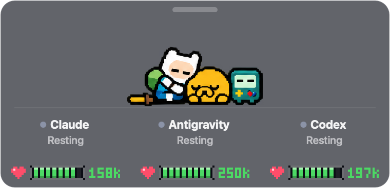
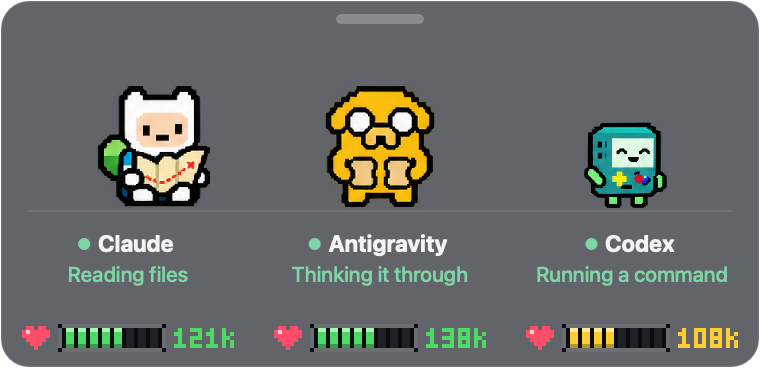
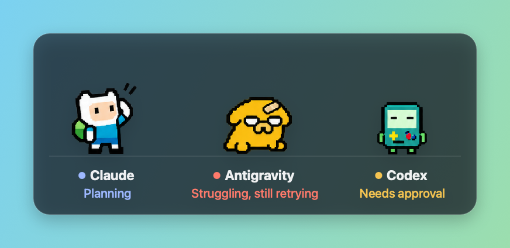
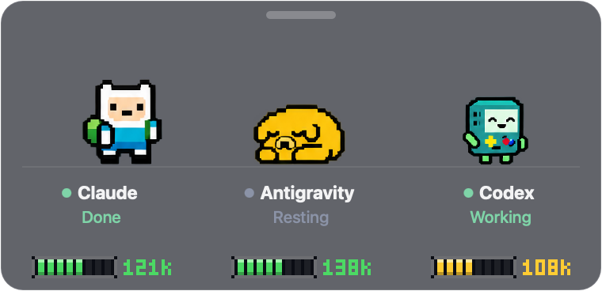

# AgentTime 🗡️🐶🎮

**Your AI agents, but make it Adventure Time.**

Finn, Jake and BMO hang out in a little window in the corner of your Mac and act out what your AI coding agents are up to, so you can tell at a glance who's busy, who's stuck, and who just finished.



## Meet the crew

| Your agent | Their buddy | When it's working… |
|---|---|---|
| **Claude Code** | **Finn** | studies his adventure map |
| **Antigravity** | **Jake** | makes himself a sandwich |
| **Codex** | **BMO** | dances and plays games |

When nobody has anything to do, all three curl up together for a nap. As soon as one of your agents starts a task, only its buddy wakes up and gets to work. The others keep snoozing.



## They have feelings (sort of)

- 🤔 **Planning:** Finn scratches his hat and thinks hard.
- 😅 **Something failed:** arms get tangled and they try again.
- 🩹 **Failed a few times in a row:** they look worn out and grab a bandage.
- ✋ **Needs your OK:** they wait patiently and the label says *Needs approval*.
- 🎉 **Done:** a quick victory pose (Finn's sword salute is the best), then back to napping.





Every buddy also has a little label underneath saying exactly what's going on, so the cute part never hides the real status.

## Install it with a prompt

Copy this into your AI agent (Claude Code, Codex, Antigravity, or whatever you use) and let it do the work:

```text
Install AgentTime (https://github.com/nehapandeymn-tech/AgentTime) on this Mac:

1. Clone it to ~/AgentTime. It needs the Xcode Command Line Tools; if swiftc is
   missing, tell me to run xcode-select --install and stop.
2. In ~/AgentTime run ./build.sh --install (builds, tests, copies to /Applications).
3. Run ./scripts/connect.sh (hooks up Claude Code and Antigravity if I have them;
   Codex needs nothing). It keeps my existing settings and backs them up first.
4. Run: open /Applications/AgentTime.app
5. Tell me Finn (Claude), Jake (Antigravity) and BMO (Codex) now live in the
   bottom-right corner: drag them anywhere, right-click for options.
```

Prefer doing it yourself?

```sh
git clone https://github.com/nehapandeymn-tech/AgentTime ~/AgentTime
cd ~/AgentTime && ./build.sh --install && ./scripts/connect.sh
open /Applications/AgentTime.app
```

## Little things to know

- **It never gets in your way:** when your mouse goes over the widget, it fades almost invisible and clicks go straight through to whatever is behind it.
- **Move it:** grab the little bar along the top and drag it anywhere. Hover that bar to see how all three are doing at once.
- **Options:** right-click the top bar (or use the menu-bar icon) to pause the animations, hide it, or turn on the optional **Ice King** cameo for really tough tasks.
- **Private by design:** it only notices *that* something happened, like "a task started" or "a step failed". It never reads your prompts, your code or your conversations.

## Saying goodbye

```sh
cd ~/AgentTime && ./scripts/disconnect.sh
```

Then quit the app and drag **AgentTime** from Applications to the Trash.

## Credits

This is an unofficial fan project, made for fun. Finn, Jake, BMO, the Ice King and Adventure Time belong to Cartoon Network, and this project isn't affiliated with or endorsed by them. The pixel art is fan-made for this project.

Curious how it works under the hood? See [docs/HOW-IT-WORKS.md](docs/HOW-IT-WORKS.md).
