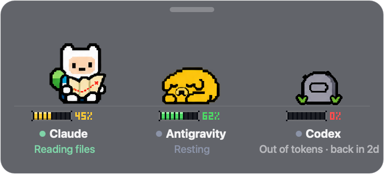

# AgentTime 

**Your AI agents, but make it Adventure Time.**

Finn, Jake and BMO hang out in a little window in the corner of your Mac and act out what your AI coding agents are up to, so you can tell at a glance who's busy, who's stuck, and who just finished.


## Meet the crew

| Your agent | Their buddy | When it's working… |
|---|---|---|
| **Claude Code** | **Finn** | studies his adventure map |
| **Antigravity** | **Jake** | makes himself a sandwich |
| **Codex** | **BMO** | dances and plays games |

When nobody has anything to do, all three curl up together for a nap. As soon as one of your agents starts a task, only its buddy wakes up and gets to work. The others keep snoozing.


## They have feelings (sort of)

- 🤔 **Planning:** Finn scratches his hat and thinks hard.
- 😅 **Something failed:** arms get tangled and they try again.
- 🩹 **Failed a few times in a row:** they look worn out and grab a bandage.
- ✋ **Needs your OK:** they wait patiently and the label says *Needs approval*.
- 🎉 **Done:** a quick victory pose (Finn's sword salute is the best), then back to napping.


Every buddy also has a little label underneath saying exactly what's going on, so the cute part never hides the real status.

## Health bars and tombstones 🪦

Right under each buddy is a little pixel health bar showing how much of that agent's **usage limit** is left. It counts down as you use it, and only fills back up when the limit resets. The bar always shows the tighter of the 5-hour and weekly limits, as a percentage, because that's how Claude, Codex and Antigravity themselves report it.

- 🟩 **Green:** plenty left. 🟨 **Yellow:** under half. 🟥 **Red:** under a fifth. Nearly empty, it blinks.
- **Two accounts?** Normally each buddy has one bar. If you use two Claude accounts (for example a second one through a `CLAUDE_CONFIG_DIR` alias), Finn gets one bar per account, labelled with the alias name. To rename or reorder them (say, "work" on top), create `~/.agent-companions/accounts.json`:

  ```json
  { "claude": [ { "dir": "~/.claude", "name": "work" }, { "dir": "~/.personal", "name": "personal" } ] }
  ```
- **Out of tokens:** when every account an agent has is used up, its buddy gets tired, collapses, goes *poof*… and a tombstone appears in its place, with a label saying when the limit comes back. As long as one account still has some left, the buddy stays alive. When the limit resets, they pop right back.



## "Needs you!"

When Codex (or Claude) is stuck waiting for you to approve something, the buddy gets a bouncing **!** bubble, the label flashes *Needs approval*, and the menu bar says **Needs you** next to Finn's face, so a command never sits waiting for you unnoticed.

## Install it with a prompt

Copy this into your AI agent (Claude Code, Codex, Antigravity, or whatever you use) and let it do the work:

```text
Install AgentTime (https://github.com/nehapandeymn-tech/AgentTime) on this Mac:

1. Clone it to ~/AgentTime. It needs the Xcode Command Line Tools; if swiftc is
   missing, tell me to run xcode-select --install and stop.
2. In ~/AgentTime run ./build.sh --install (builds, tests, copies to /Applications).
3. Run ./scripts/connect.sh (hooks up Claude Code, every Claude account I use through
   a CLAUDE_CONFIG_DIR alias, and Antigravity; Codex needs nothing). It adds hooks and
   a status line, keeps my existing settings (and status line) and backs them up first.
4. Run: open /Applications/AgentTime.app
5. Tell me Finn (Claude), Jake (Antigravity) and BMO (Codex) now live in the
   bottom-right corner: drag them anywhere, right-click for options.
```

Prefer doing it yourself?

```sh
git clone https://github.com/nehapandeymn-tech/AgentTime ~/AgentTime
cd ~/AgentTime && ./build.sh --install && ./scripts/connect.sh
open /Applications/AgentTime.app
```

## Little things to know

- **It never gets in your way:** when your mouse goes over the widget, it fades almost invisible and clicks go straight through to whatever is behind it.
- **Move it:** grab the little bar along the top and drag it anywhere.
- **Options:** right-click the top bar (or use the menu-bar icon) to pause the animations, hide it, or turn on the optional **Ice King** cameo for really tough tasks.
- **Private by design:** it only notices *that* something happened, like "a task started" or "a step failed", plus how much of your usage limit is left (from each agent's status line or logs). It never stores or shows your prompts, your code or your conversations.

## Saying goodbye

```sh
cd ~/AgentTime && ./scripts/disconnect.sh
```

Then quit the app and drag **AgentTime** from Applications to the Trash.

## Credits

This is an unofficial fan project, made for fun. Finn, Jake, BMO, the Ice King and Adventure Time belong to Cartoon Network, and this project isn't affiliated with or endorsed by them. The pixel art is fan-made for this project.

Curious how it works under the hood? See [docs/HOW-IT-WORKS.md](docs/HOW-IT-WORKS.md).
